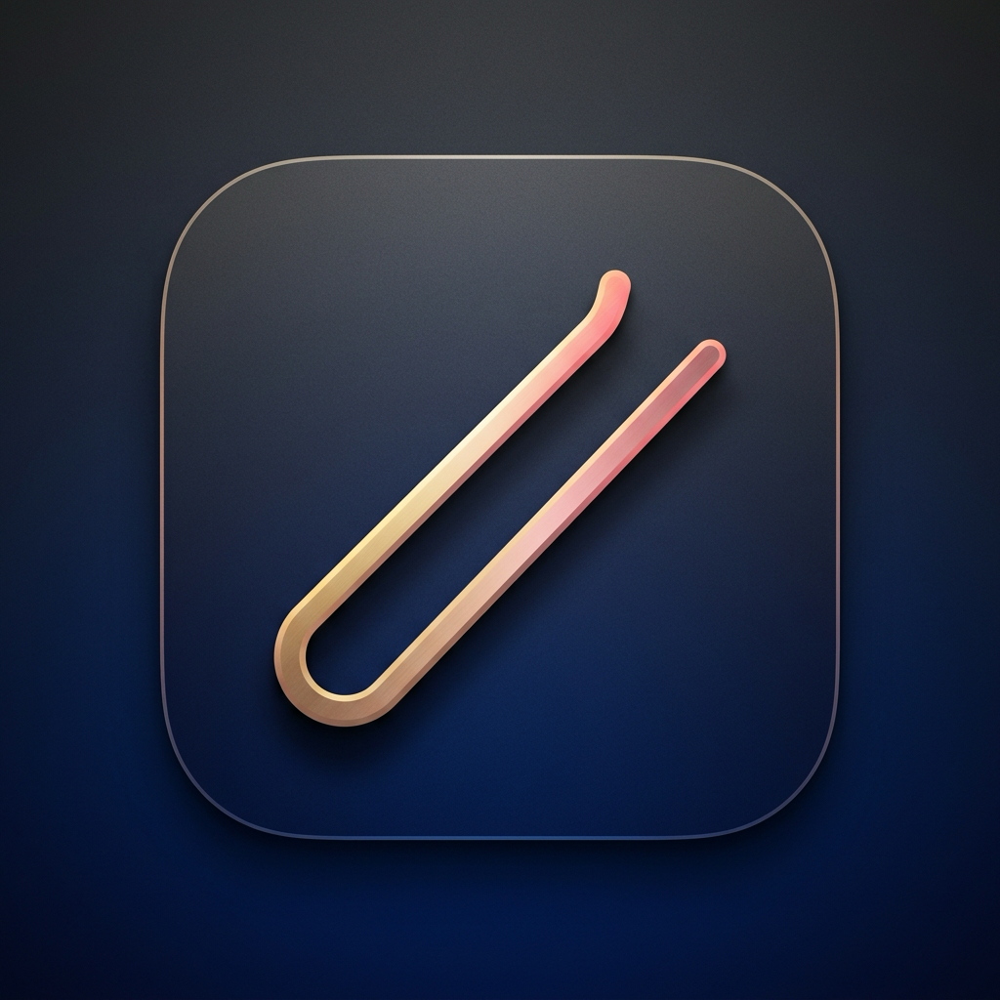

<div align="center">

# ✦ Hairpin

**Tame your menu bar. Reclaim the notch.**

A lightweight, privacy-first macOS menu bar manager for notched MacBooks.




</div>

---

## The Problem

On notch-equipped MacBook Pro / Air models, status bar icons pile up and get **swallowed behind the camera housing**. macOS offers no native way to scroll, wrap, or access those hidden icons.

## The Solution

Hairpin uses a non-invasive dual-`NSStatusItem` technique to fold your menu bar icons behind an intelligent separator — no SIP disabling, no code injection, no accessibility permissions.

---

## ✨ Features

| Feature | Description |
| :--- | :--- |
| **One-Click Fold** | Left-click the Hairpin icon to collapse/expand hidden icons |
| **Notch-Aware Panel** | Floating panel slides out below the notch to reveal folded items |
| **Auto-Collapse** | Icons automatically fold back after a configurable delay |
| **Hover Expand** | Optionally expand when hovering near the menu bar or notch |
| **Global Hotkey** | `⌘⇧B` to toggle from anywhere — no accessibility permission needed |
| **Draggable Separator** | Hold `⌘` and drag the separator to choose which icons to hide |
| **Privacy-First** | Zero network, zero keylogging, zero screen capture |

---

## 🚀 Quick Start

### Build from source

```bash
git clone <repo-url> && cd Hairpin

# Build & run
make run

# Or step by step
make build
open build/Hairpin.app
```

### Create installer DMG

```bash
make dmg
# → build/Hairpin-1.0.0.dmg
```

### Install to Applications

```bash
make install
```

---

## 🏗 Project Structure

```
Hairpin/
├── Package.swift                    # SPM manifest (macOS 13+, Swift 5 mode)
├── Makefile                         # Build, run, install, DMG commands
├── build_app.sh                     # .app bundler + DMG creator
│
└── Hairpin/
    ├── Resources/
    │   ├── AppIcon.icns             # App icon (all sizes)
    │   ├── Info.plist               # LSUIElement, ATS, bundle metadata
    │   ├── Hairpin.entitlements     # Security entitlements
    │   └── PrivacyInfo.xcprivacy    # Apple Privacy Manifest
    │
    └── Sources/
        ├── App/
        │   ├── main.swift           # Entry point
        │   └── AppDelegate.swift    # Lifecycle, wiring
        │
        ├── MenuBar/
        │   ├── MenuBarManager.swift # Dual-NSStatusItem folding engine
        │   └── MouseTracker.swift   # On-demand mouse tracking
        │
        ├── Notch/
        │   ├── NotchDetector.swift  # safeAreaInsets + auxiliaryTopRightArea
        │   └── FloatingPanelController.swift  # Below-notch floating panel
        │
        ├── Settings/
        │   └── SettingsView.swift   # SwiftUI preferences (4 tabs)
        │
        └── Utils/
            ├── Models.swift         # Enums & types
            ├── HotKeyManager.swift  # Carbon RegisterEventHotKey
            └── UserDefaultsExtensions.swift  # Namespaced prefs
```

---

## 🔒 Privacy Architecture

Hairpin is designed with a **zero-trust, zero-permission** philosophy:

- **No Accessibility Permission** — Uses Carbon `RegisterEventHotKey` instead of `NSEvent` global monitors for the hotkey. The OS only dispatches the exact registered combination; no other keystrokes are ever visible to the app.
- **On-Demand Mouse Tracking** — Global mouse monitor is only active when needed (during auto-collapse or hover-expand). Coordinates are used for transient hit-testing and never stored.
- **No Screen Capture** — Pure native `NSPanel` UI. No `ScreenCaptureKit`, no `CGWindowList`.
- **No Network** — Zero dependencies. No analytics, telemetry, or crash reporters. `NSAppTransportSecurity` is locked down in Info.plist.
- **Apple Privacy Manifest** — Ships with `PrivacyInfo.xcprivacy` declaring zero data collection.

---

## ⚙️ How It Works

The core technique:

1. **Two `NSStatusItem`s** are created — a **toggle button** (always visible) and a **separator** (draggable anchor).
2. **Collapse**: `separator.length = 10000` pushes everything to its left off-screen.
3. **Expand**: `separator.length = 20` restores the thin separator; icons reappear.
4. **Notch detection**: `NSScreen.safeAreaInsets.top > 0` indicates a notch; `auxiliaryTopRightArea` gives the available width.

---

## 📋 Requirements

- macOS 13.0 (Ventura) or later
- Apple Silicon or Intel Mac
- Swift 6.0+ toolchain (for building from source)

---

## License

MIT
