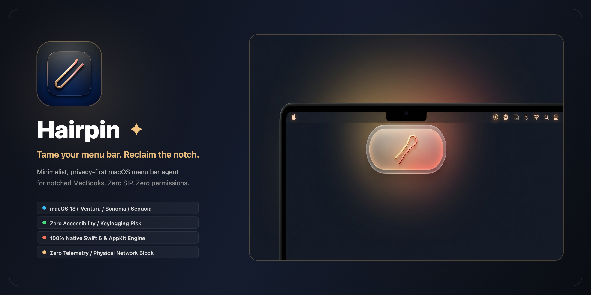

<div align="center">

<a href="https://github.com/Moon-Meld/Hairpin">
  
</a>

<br/>

<p align="center">
  <a href="https://github.com/Moon-Meld/Hairpin/releases/latest">
    
  </a>
  <a href="#-quick-start">
    
  </a>
  <a href="README_zh.md">
    
  </a>
</p>

<p align="center">
  
  
  
  
  
</p>

</div>

---

## ⚡️ The Problem

On modern MacBook Pro and MacBook Air displays, the **camera housing (Notch)** splits the menu bar into two disjoint halves. When background apps multiply, their status bar icons extend leftward until they collide with the notch:

1. **System Swallowing**: macOS abruptly truncates overflowing icons behind the physical cutout with no scrollbar, overflow menu, or native toggle.
2. **Invisible Services**: Critical utilities (VPNs, cloud sync, battery monitors) become unreachable.
3. **Visual Clutter**: The visible space becomes congested with low-priority background icons.

---

## 💡 The Hairpin Solution

Hairpin introduces a **dual-`NSStatusItem` variable-width engine** combined with **hardware notch sensing**:

* **One-Click Folding**: Instantly tuck low-frequency icons away behind a customizable separator.
* **Notch Overflow Drawer**: A floating, frosted-glass Dynamic Island panel pops up snugly underneath the notch whenever folded icons need viewing.
* **Zero System Intrusion**: No SIP disabling required, no private API hooking, no Accessibility keylogging permissions.

---

## ✨ Feature Highlights

| Capability | Experience | Technical Highlight |
| :--- | :--- | :--- |
| **🧲 Smart Folding** | Click the toggle to collapse or expand hidden icons smoothly. | Uses a 10,000pt variable spacer length to push icons into the safe zone. |
| **🏝 Dynamic Drawer** | Slides gracefully underneath the physical camera notch. | Liquid physics entrance powered by `CAMediaTimingFunction` and `NSVisualEffectView`. |
| **⏱ Auto-Collapse** | Automatically re-folds after the cursor leaves the menu bar. | Configurable timer (Immediate, 3s, 5s, 10s, or Never). |
| **👀 Hover to Reveal** | Move the cursor over the notch to expand icons automatically. | On-demand geometric hit-testing without continuous background tracking. |
| **⌨️ Global Hotkey** | Toggle anywhere with <kbd>⌘</kbd> + <kbd>⇧</kbd> + <kbd>B</kbd>. | Low-level Carbon `RegisterEventHotKey` — **no Accessibility permission required**. |
| **🎨 Draggable Anchor** | Hold <kbd>⌘</kbd> and drag the separator to select what to hide. | Supports custom styles: invisible, vertical bar `\|`, dot `•`, or chevrons `‹` `›`. |

---

## ⚙️ How It Works

<p align="center">
  
</p>

### 1. Dual-Status Spacer Technique
Unlike tools that attempt to inject code into `WindowServer` or other processes, Hairpin allocates two coordinated `NSStatusItem`s:
- **Toggle Item**: The always-visible trigger button anchored on the far right.
- **Separator Item**: The draggable boundary placed to the left of the items you wish to keep visible.
- **Collapsed**: The separator's length expands to `10,000pt`, smoothly shunting all status items to its left off the visible display boundary.
- **Expanded**: The separator shrinks back to a thin divider (`1pt`–`20pt`), instantly restoring all hidden icons.

### 2. Notch Hardware Awareness
```swift
// Real-time detection via Apple AppKit display metrics
let hasNotch = screen.safeAreaInsets.top > 0
if let auxRight = screen.auxiliaryTopRightArea {
    let usableWidth = auxRight.width
    let notchBoundary = auxRight.minX
}
```
Hairpin continuously listens for display topology changes (e.g. plugging in an external monitor) and recalibrates geometry automatically.

---

## 📊 Feature Comparison

| Feature | **Hairpin** | **Bartender 5** | **Hidden Bar** | **Ice** |
| :--- | :---: | :---: | :---: | :---: |
| **License / Pricing** | **Free & Open Source (MIT)** | $16 Commercial | Free / Abandoned | Free & Open Source |
| **SIP Disabled Required** | **No (100% Native)** | No (uses Accessibility) | No | No |
| **Accessibility Permissions** | **Not Required** | Required | Required for hotkeys | Required for hotkeys |
| **Screen Recording Permission** | **Not Required** | Required for previews | Not Required | Required for styling |
| **Notch Drawer / Floating Panel** | **Yes (Dynamic Island)** | Menu bar sub-bar | No | Floating Bar |
| **Network Telemetry** | **None (Zero Network)** | Has update telemetry | None | None |
| **Swift 6 & macOS 15 Ready** | **Yes** | Yes | No | Yes |

---

## ⌨️ Shortcuts & Gestures

| Action | Gesture / Shortcut | Description |
| :--- | :--- | :--- |
| **Toggle Folding** | `Left-Click` on Hairpin icon | Instantly collapse or expand hidden icons. |
| **Quick Settings Menu** | `Right-Click` on Hairpin icon | Access auto-collapse timers, preferences, and quit. |
| **Global Hotkey** | <kbd>⌘ Command</kbd> + <kbd>⇧ Shift</kbd> + <kbd>B</kbd> | Toggle menu bar state from any application. |
| **Reposition Separator** | <kbd>⌘ Command</kbd> + `Drag` separator icon | Choose which icons remain visible vs folded. |
| **Hover Expand** | Hover over notch area for `0.5s` | Automatically reveals folded icons (when enabled). |

---

## 🚀 Quick Start

### Option 1: Pre-built DMG Installer (Recommended)

1. Download the latest release from the [Releases](https://github.com/Moon-Meld/Hairpin/releases) page.
2. Open `Hairpin-1.0.0.dmg` and drag **Hairpin** to your `/Applications` folder.
3. Launch Hairpin — the icon will appear in your top-right menu bar immediately.

### Option 2: Build from Source

Requirements: macOS 13.0+, Xcode CommandLineTools (`xcode-select --install`).

```bash
# 1. Clone repository
git clone https://github.com/Moon-Meld/Hairpin.git
cd Hairpin

# 2. Build & run instantly
make run

# 3. (Optional) Generate production release DMG
make dmg
# Output: build/Hairpin-1.0.0.dmg

# 4. (Optional) Install directly to /Applications
make install
```

---

## 🔒 Privacy by Design

Hairpin is engineered with strict **Zero-Trust & Zero-Permission** principles:

```
┌─────────────────────────────────────────────────────────────┐
│                   HAIRPIN PRIVACY POLICY                    │
├──────────────────────────┬──────────────────────────────────┤
│ 🚫 No Network Activity   │ Info.plist ATS blocks all traffic│
│ ⌨️ Zero Keylogger Risk   │ Uses Carbon RegisterEventHotKey  │
│ 👁 No Screen Recording   │ Zero display frame buffer access │
│ ⏱ On-Demand Mouse Scan   │ Deactivates when not in use      │
│ 📋 Apple Privacy Manifest│ Ships with PrivacyInfo.xcprivacy │
└──────────────────────────┴──────────────────────────────────┘
```

* **No Accessibility Prompts**: Unlike conventional menu utilities that use `NSEvent.addGlobalMonitorForEvents` (which intercepts all keyboard inputs like a keylogger), Hairpin relies strictly on Carbon's `RegisterEventHotKey`. The operating system only dispatches an event when the exact ⌘⇧B key combination is pressed.
* **On-Demand Sensor**: The cursor tracker is dormant whenever Hairpin is collapsed in click-only mode. Coordinates are compared transiently and never stored or logged.
* **Apple Privacy Manifest**: Formally complies with Apple's macOS 14+ privacy requirements via [PrivacyInfo.xcprivacy](Hairpin/Resources/PrivacyInfo.xcprivacy).

---

## 📂 Project Structure

```text
Hairpin/
├── Package.swift                    # Swift Package Manager manifest (macOS 13+, Swift 5/6)
├── Makefile                         # Unified commands (build, run, release, dmg, install)
├── build_app.sh                     # Automated .app bundler & DMG packager
├── README.md                        # English documentation
├── README_zh.md                     # 简体中文文档
│
├── docs/
│   └── assets/
│       ├── hero-banner.jpg          # High-resolution showcase banner
│       ├── banner.svg               # Vector brand badge & overview
│       └── how-it-works.svg         # Architecture & mechanism diagram
│
└── Hairpin/
    ├── Resources/
    │   ├── AppIcon-1024.png         # 1024px master icon
    │   ├── AppIcon.icns             # Multi-resolution macOS icon bundle
    │   ├── Info.plist               # LSUIElement=YES & ATS network isolation
    │   ├── Hairpin.entitlements     # Hardened runtime definitions
    │   └── PrivacyInfo.xcprivacy    # Apple Privacy Manifest
    │
    └── Sources/
        ├── App/                     # Entry point & application lifecycle
        ├── MenuBar/                 # Dual status item engine & mouse tracking
        ├── Notch/                   # Safe area detection & dynamic floating panel
        ├── Settings/                # SwiftUI 4-tab preferences interface
        └── Utils/                   # HotKeyManager & namespaced persistence
```

---

## 💬 FAQ

<details>
<summary><b>Q: Why doesn't Hairpin require Accessibility or Screen Recording permissions?</b></summary>
<br/>
Most menu bar managers hook deep into WindowServer or capture window lists to redraw icons, requiring sensitive permissions. Hairpin works within standard AppKit status item capabilities by adjusting spacers, and registers global hotkeys via Carbon HIToolbox, completely avoiding privileged permission prompts.
</details>

<details>
<summary><b>Q: How do I choose which icons are hidden?</b></summary>
<br/>
Hold the <kbd>⌘ Command</kbd> key and drag the Hairpin Separator icon (`|`) in your menu bar. Every status icon positioned to the left of the separator will be folded when Hairpin is collapsed.
</details>

<details>
<summary><b>Q: Does Hairpin work on Macs without a notch?</b></summary>
<br/>
Yes! On notchless displays (Mac mini, Mac Studio, iMac, or external monitors), Hairpin functions as a high-performance menu bar folding utility, with the floating drawer appearing centered below the menu bar.
</details>

---

## 📄 License

This project is open-source under the [MIT License](LICENSE).  
Contributions and stars are always welcome! ⭐️

<div align="center">
<sub>Crafted with passion for the Mac community. Designed for Apple Silicon &amp; macOS Ventura, Sonoma, and Sequoia.</sub>
</div>
