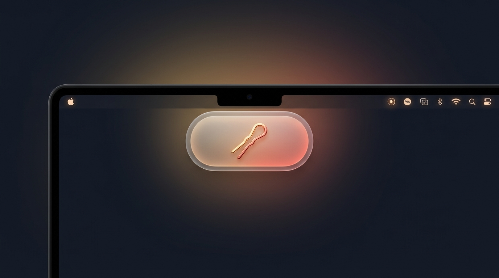
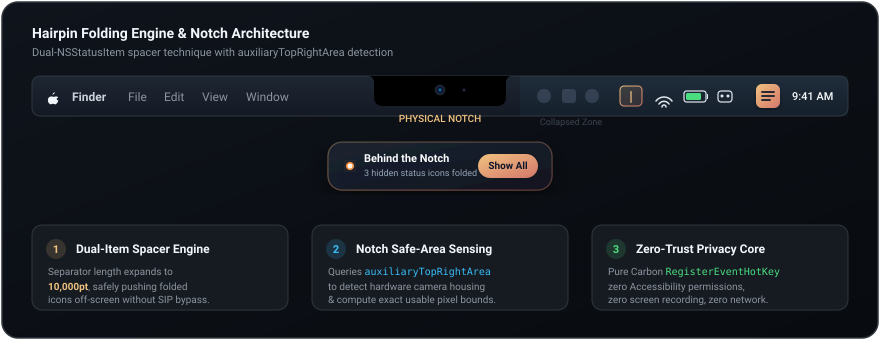

<div align="center">

<p align="center">
  
</p>

# ✦ Hairpin

### **整理杂乱菜单栏，释放刘海屏空间。**

专为配备刘海屏的 MacBook 打造的原生极简菜单栏管理工具。<br/>
无需关闭 SIP、无需辅助功能权限、零网络请求，彻底告别图标被刘海遮挡与截断的烦恼。

<br/>

[](https://apple.com/macos)
[](https://swift.org)
[](LICENSE)
[](#-零信任隐私安全设计)

<br/>

[**下载预编译 DMG (v1.0.0)**](https://github.com/Moon-Meld/Hairpin/releases) • [**快速上手**](#-快速上手) • [**原理解析**](#-核心工作原理) • [**English README**](README.md)

</div>

---

## ⚡️ 痛点背景

在配备刘海（Notch）的 MacBook Pro 与 MacBook Air 机型上，菜单栏被物理摄像头区域分割为左右两部分。当后台常驻应用增多时，右侧状态栏图标向左延伸：

1. **系统粗暴截断**：一旦触碰刘海边界，macOS 会直接将多余图标**隐藏在物理刘海后方**，没有任何滚动、折叠或原生展开入口。
2. **常驻服务失联**：许多关键工具（网速监控、VPN、云同步、输入法等）由于被刘海吞没而无法查看与点击。
3. **视觉严重杂乱**：日常高频图标与低频常驻图标混在一起，侵占宝贵的屏幕安全空间。

---

## 💡 Hairpin 的优雅解法

Hairpin 采用 **双 `NSStatusItem` 可变宽度占位引擎** 与 **刘海硬件安全区感知** 双核驱动：

* **一键折叠收纳**：按住 <kbd>⌘</kbd> 拖动分隔符，一键将低频图标折叠收纳，根源释放刘海右侧空间。
* **灵动岛二级抽屉**：刘海下方优雅弹出磨砂玻璃悬浮抽屉（Dynamic Island Floating Panel），点击随时呼出隐藏图标。
* **零侵入原生体验**：免关闭系统 SIP 完整性保护、免屏幕录制权限、免键盘记录辅助功能权限。

---

## ✨ 核心特性一览

| 核心特性 | 用户体验 | 底层技术实现 |
| :--- | :--- | :--- |
| **🧲 一键折叠收纳** | 单击 Hairpin 按钮，秒级收纳/展开菜单栏图标。 | 分隔符宽度置为 10,000pt，平滑将左侧图标自然推入屏幕外。 |
| **🏝 灵动岛悬浮抽屉** | 紧贴在屏幕刘海正下方呼出半透明圆角抽屉。 | 基于 `CAMediaTimingFunction` 与贝塞尔物理弹簧动画打造。 |
| **⏱ 智能自动收起** | 鼠标移出菜单栏区域后自动重新折叠收起。 | 支持自定义延迟（立即、3秒、5秒、10秒、从不）。 |
| **👀 悬停自动展开** | 鼠标在刘海或菜单栏空白处悬停 0.5s 自动唤出。 | 按需触发几何碰撞检测，常态折叠时完全休眠，零额外能耗。 |
| **⌨️ 全局快捷键** | 任意界面随时按下 <kbd>⌘</kbd> + <kbd>⇧</kbd> + <kbd>B</kbd> 切换。 | 基于 Carbon 底层 `RegisterEventHotKey`，**无需授予“辅助功能”权限**。 |
| **🎨 个性化分隔符** | 按住 <kbd>⌘</kbd> 随意拖动位置，支持丰富图标形态。 | 支持完全隐形、细竖线 `\|`、圆点 `•`、箭头 `‹` `›` 等多种外观。 |

---

## ⚙️ 核心工作原理

<p align="center">
  
</p>

### 1. 双图标可变宽度占位机制
macOS 不允许直接挪动其他第三方 App 的 `NSStatusItem` 句柄。Hairpin 采用了无侵入的占位架构：
- **控制按钮 (Toggle Item)**：始终位于最右侧，用于展开/折叠及右键呼出偏好设置。
- **分隔锚点 (Separator Item)**：位于控制按钮左侧，按住 <kbd>⌘</kbd> 键可将其拖拽到要隐藏的图标右侧。
- **折叠状态 (Collapsed)**：将分隔符长度设置为 `10,000pt`，系统会自动将分隔符左侧的所有第三方图标推向屏幕安全区以外。
- **展开状态 (Expanded)**：分隔符恢复至细线宽度（`1pt`–`20pt`），隐藏的图标瞬间完整复原。

### 2. 刘海硬件安全区计算
```swift
// 实时获取屏幕安全区与刘海可用范围
let hasNotch = screen.safeAreaInsets.top > 0
if let auxRight = screen.auxiliaryTopRightArea {
    let availableWidth = auxRight.width
    let notchMinX = auxRight.minX
}
```
应用内部监听 `NSApplication.didChangeScreenParametersNotification`，外接显示器插拔时自动刷新适配。

---

## 📊 同类工具深度对比

| 对比维度 | **Hairpin** | **Bartender 5** | **Hidden Bar** | **Ice** |
| :--- | :---: | :---: | :---: | :---: |
| **软件定价** | **完全免费 & 开源 (MIT)** | 16 美元付费授权 | 免费 (已停更/弃坑) | 免费开源 |
| **关闭 SIP 保护** | **不需要 (100% 原生)** | 不需要 (但需辅助功能) | 不需要 | 不需要 |
| **辅助功能敏感权限** | **不需要** | 必须开启 | 快捷键必须开启 | 快捷键必须开启 |
| **屏幕录制敏感权限** | **不需要** | 需开启以支持预览 | 不需要 | 需开启样式功能 |
| **刘海屏二级抽屉** | **有 (灵动岛悬浮窗)** | 菜单栏下延次级栏 | 无 | 悬浮条 |
| **网络外传与遥测** | **零网络 (完全封锁)** | 有版本与遥测请求 | 无 | 无 |
| **macOS 15 & Swift 6** | **原生适配** | 适配 | 存在并发崩溃问题 | 适配 |

---

## ⌨️ 快捷键与操作手势

| 操作目标 | 触发手势 / 快捷键 | 详细说明 |
| :--- | :--- | :--- |
| **展开 / 折叠菜单栏** | `左键单击` Hairpin 图标 | 瞬间收起或展开折叠区域。 |
| **快捷菜单与设置** | `右键单击` Hairpin 图标 | 快速切换自动折叠延迟、打开设置或退出。 |
| **全局快捷键切换** | <kbd>⌘ Command</kbd> + <kbd>⇧ Shift</kbd> + <kbd>B</kbd> | 在任意前台全屏 App 中快速呼出。 |
| **调整折叠分界点** | 按住 <kbd>⌘ Command</kbd> + `拖动` 分隔符 | 分隔符左侧的图标将被折叠隐藏。 |
| **滑过触発展开展开** | 鼠标滑入刘海正下方悬停 `0.5秒` | 适合日常快速查看时间、网速等后台状态。 |

---

## 🚀 快速上手

### 方式 1：下载预编译 DMG 安装镜像（推荐）

1. 前往 GitHub Releases 页面下载最新版 [Hairpin-1.0.0.dmg](https://github.com/Moon-Meld/Hairpin/releases)。
2. 双击打开镜像，将 **Hairpin** 拖动至 `/Applications`（应用程序）目录。
3. 启动应用，菜单栏右侧将立即常驻 Hairpin 极简图标。

### 方式 2：本地源码编译安装

运行环境要求：macOS 13.0+，且安装有 Xcode Command Line Tools（`xcode-select --install`）。

```bash
# 1. 克隆代码仓库
git clone https://github.com/Moon-Meld/Hairpin.git
cd Hairpin

# 2. 一键编译并启动
make run

# 3. (可选) 打包独立发布的 DMG 镜像
make dmg
# 输出文件: build/Hairpin-1.0.0.dmg

# 4. (可选) 直接安装到当前系统 /Applications
make install
```

---

## 🔒 零信任隐私安全设计

Hairpin 采用严苛的 **Zero-Trust（零信任）** 与 **Zero-Permission（零权限）** 理念构建：

```
┌─────────────────────────────────────────────────────────────┐
│                    HAIRPIN 隐私保护公约                      │
├──────────────────────────┬──────────────────────────────────┤
│ 🚫 物理级零网络连接     │ Info.plist ATS 强制封锁所有流量   │
│ ⌨️ 零按键监听风险       │ 使用 Carbon RegisterEventHotKey  │
│ 👁 拒绝屏幕录制权限     │ 零读取其他 App 窗口或屏幕缓冲区  │
│ ⏱ 按需动态鼠标感知     │ 常态折叠时监听器彻底休眠注销     │
│ 📋 苹果官方隐私清单     │ 内置合规 PrivacyInfo.xcprivacy    │
└──────────────────────────┴──────────────────────────────────┘
```

* **彻底免除辅助功能权限**：传统工具使用 `NSEvent.addGlobalMonitorForEvents` 监听按键，本质上与键盘记录器（Keylogger）权限一致，会触发 macOS 系统的隐私告警。Hairpin 改用 Carbon `RegisterEventHotKey` 向系统注册特定热键，操作系统仅在命中 ⌘⇧B 时定向唤醒，**应用在底层完全无法截获用户的任何其他输入**。
* **坐标用后即焚**：鼠标追踪仅在必要时动态激活，坐标仅在内存做纯数学矩形判定，绝不向硬盘或网络记录任何轨迹。
* **官方合规规范**：资源包中内置 [PrivacyInfo.xcprivacy](Hairpin/Resources/PrivacyInfo.xcprivacy)，完全符合苹果 macOS 14+ 隐私合规体系。

---

## 📂 工程目录一览

```text
Hairpin/
├── Package.swift                    # SPM 清单文件 (macOS 13+, Swift 5/6 模式)
├── Makefile                         # 常用工程指令 (build, run, release, dmg, install)
├── build_app.sh                     # 自动化打包与 DMG 制作工具
├── README.md                        # 英文主页文档
├── README_zh.md                     # 中文主页文档
│
├── docs/
│   └── assets/
│       ├── hero-banner.jpg          # 4K 高清动态岛实机氛围海报
│       ├── banner.svg               # 矢量品牌 Header 徽标
│       └── how-it-works.svg         # 架构原理解析信息图
│
└── Hairpin/
    ├── Resources/
    │   ├── AppIcon-1024.png         # 1024px 高清源图标
    │   ├── AppIcon.icns             # 全规格 Retina macOS 原生图标包
    │   ├── Info.plist               # LSUIElement 常驻与网络安全沙盒
    │   ├── Hairpin.entitlements     # 签名权限配置
    │   └── PrivacyInfo.xcprivacy    # 苹果官方隐私清单
    │
    └── Sources/
        ├── App/                     # 入口生命周期 (AppDelegate & main)
        ├── MenuBar/                 # 双状态栏折叠引擎与动态事件监听
        ├── Notch/                   # 屏幕刘海几何计算与灵动岛悬浮抽屉
        ├── Settings/                # SwiftUI 四标签页现代偏好设置
        └── Utils/                   # Carbon 快捷键管理器与命名空间持久化
```

---

## 💬 常见问题 (FAQ)

<details>
<summary><b>Q: 为什么 Hairpin 不需要辅助功能（Accessibility）或屏幕录制权限？</b></summary>
<br/>
同类工具常因需要向 WindowServer 注入代码或抓取第三方窗口像素而必须索取系统级敏感权限。Hairpin 严格在 AppKit 公开 API 边界内工作（通过可变宽度空白占位），全局快捷键也采用系统级别的 Carbon 事件派发机制，因此无需向用户索取任何敏感权限。
</details>

<details>
<summary><b>Q: 如何自由调整哪些图标隐藏，哪些图标常驻？</b></summary>
<br/>
按住键盘上的 <kbd>⌘ Command</kbd> 键不放，鼠标拖拽菜单栏上的 Hairpin 分隔符图标（默认为 `|`），将其放置到目标图标之间。位于分隔符**左侧**的图标会在折叠时自动收起，位于分隔符**右侧**的图标将始终可见。
</details>

<details>
<summary><b>Q: 没有刘海的旧款 Mac 或外接显示器可以使用吗？</b></summary>
<br/>
完全支持！在没有物理刘海的屏幕（如外接 4K 显示器、Mac mini、Mac Studio 等）上，Hairpin 会自动检测并以全屏菜单栏宽度作为计算基准，悬浮抽屉则居中显示在菜单栏正下方，同样提供极致的折叠与整理体验。
</details>

---

## 📄 开源许可证

本项目基于 [MIT License](LICENSE) 协议完全开源。  
欢迎提交 Issue 与 Pull Request，如果觉得好用，请为项目点亮一颗 ⭐️ Star 支持！

<div align="center">
<sub>专为 Apple Silicon 与 macOS Ventura、Sonoma 及 Sequoia 打造。让菜单栏回归秩序与优雅。</sub>
</div>
